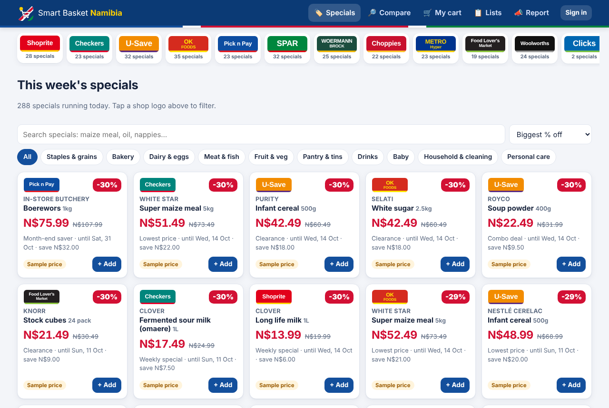
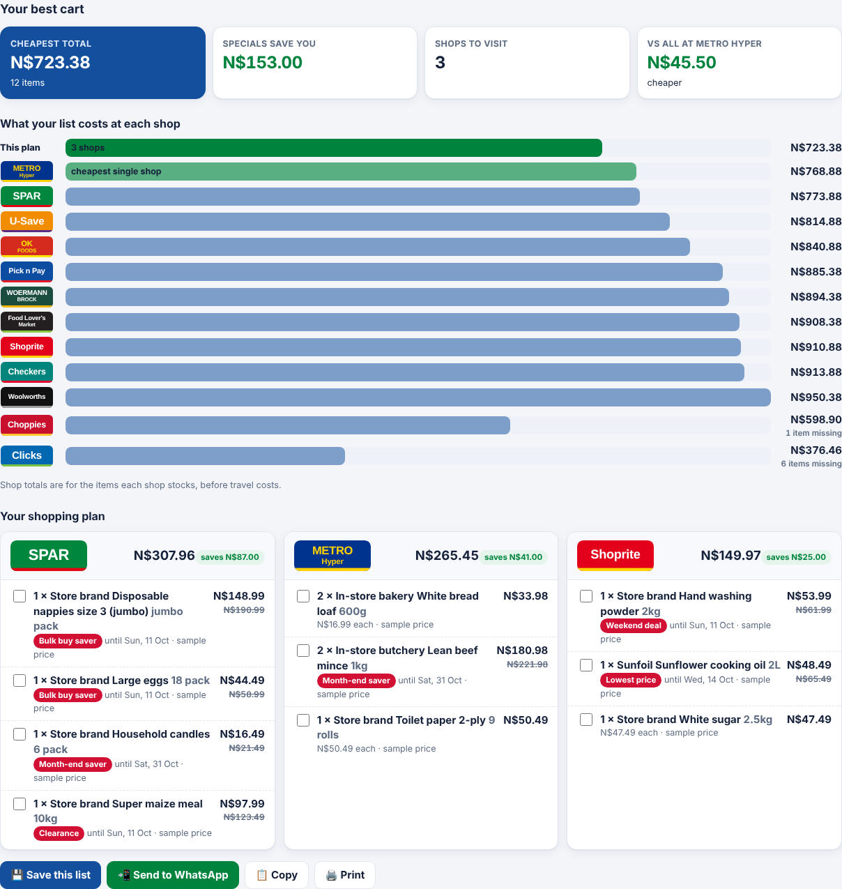
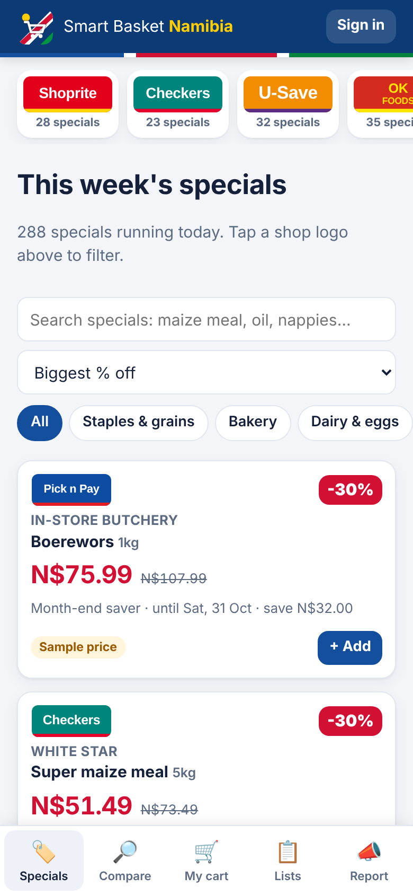

# Smart Basket Namibia 🛒🇳🇦

A web app that collects the sales, promotions and specials at Namibian supermarkets and
household suppliers. Shoppers can create an account and build the cheapest possible cart, or the
best cart that fits a budget.

**Shops included:** Shoprite, Checkers, U-Save, OK Foods, Pick n Pay, SPAR, Woermann Brock,
Choppies, Metro Hyper, Food Lover's Market, Woolworths Food and Clicks. The list lives in
`data/stores.json`, where you can add, remove or edit shops.

| Specials (desktop) | Cheapest cart | Phone |
|---|---|---|
|  |  |  |

More screenshots: [budget setup](previews/budget-setup.png), [budget cart](previews/budget-cart.png),
[price comparison on a phone](previews/mobile-compare.png). These show the built-in sample prices.

## What it does

| Page | What you can do |
|---|---|
| 🏷️ **Specials** | Every special running today, from all shops. Filter by shop (tap a logo), category or search, and sort by % off, N$ saved, price or ending soonest. Add a special to your cart in one tap. |
| 🔎 **Compare** | Search any product to see its price at every shop, cheapest first, including unit price (per kg / litre / item) and any special. |
| 🛒 **My cart → Cheapest cart** | Add items by search, or paste a whole list (`2 x bread`, `maize meal 10kg`, `18 eggs`…). Choose "any brand" or a specific brand, the shops you can reach, how many shops you'll visit, and an optional taxi/fuel cost per shop. The optimiser decides where to buy each item for the lowest total. It also shows what the whole list would cost at each single shop. |
| 💰 **My cart → Fit my budget** | Enter a budget (N$) and mark each item *Must have*, *High*, *Medium* or *Nice to have*. You get the best cart that fits: must-haves are always included, then the rest by priority, bought as cheaply as possible. It lists what didn't fit and roughly how much more each would cost. |
| 📋 **Lists** | Signed-in users save lists and budgets and reopen them any week to rebuild with new prices. A plan can also be sent to WhatsApp, copied or printed as a tick-off list for the shop. |
| 📣 **Report** | Signed-in shoppers report a special they saw in a shop or leaflet. It goes live straight away, tagged "Reported by …". |
| 👤 **Account** | Profile, town, "my shops" (the shops you can reach), password change, account deletion. |
| ⚙️ **Admin** | Import prices and specials (CSV/JSON), refresh price feeds, and turn sample prices on or off. |

Shop logos are shown throughout. By default they are badges drawn in each chain's colours. To use
a real logo file, put it in `~/.namshop/logos/<shop id>.png` (or `.svg`, `.jpg`, `.webp`) and it
replaces the badge. Logos belong to their owners, so use them with permission.

## Where the prices come from

Namibian chains publish specials mostly as printed or PDF leaflets and on social media. They don't
offer open price data, so the app takes prices from three places:

1. **Imports.** An admin types up or exports this week's leaflets as CSV/JSON and uploads them on
   the Admin page, or runs `python -m namshop import leaflet.csv`.
2. **Feeds.** Any URL that returns the same CSV/JSON format, for example from a partner retailer,
   a scraper you run elsewhere, or a shared spreadsheet published as CSV. List the URLs in
   `~/.namshop/sources.json` (see `data/sources.example.json`). The server fetches them every
   6 hours (`NAMSHOP_REFRESH_HOURS`), or on demand with `python -m namshop refresh`.
3. **Community reports.** Shoppers report specials from the Report page.

Until real data is loaded, **sample prices** fill the gaps so the app works out of the box. They
are illustrative only, are tagged "Sample price" everywhere, and change each week. A real price
always replaces the sample for that shop and product. Turn samples off on the Admin page or with
`python -m namshop sample off` once you have real data.

### Import format

CSV (comma, semicolon or tab separated) or a JSON list of objects. Header names are
case-insensitive. Only `store` and a price are required. See `data/import_template.csv`.

| Column | Meaning |
|---|---|
| `store` | Shop id or name (`shoprite`, `Pick n Pay`, …) |
| `item`, `size`, `brand`, `category` | Product, e.g. `Super maize meal`, `10kg`, `Top Score`. Leaflet-style names like `Top Score Super Maize Meal 10kg` also work: the brand and size are recognised. New products are added to the catalogue. |
| `product_id` / `item_id` | Use instead of item/brand to target an existing catalogue entry exactly. |
| `price` | Normal shelf price (N$). |
| `special_price`, `special_label` | Promo price and its name (`Weekend deal`). |
| `valid_from`, `valid_until` | Special dates, `YYYY-MM-DD` or `DD/MM/YYYY`. Expired specials stop showing automatically. |
| `branch` | Optional branch or town. |

## Run it

Needs Python 3.10+.

```bash
pip install -r namshop/requirements.txt
python -m namshop serve --open            # http://127.0.0.1:8000
```

Or double-click **`Start Smart Basket.command`** (macOS) / **`Start Smart Basket.bat`** (Windows)
in the repository folder. It sets itself up on first run and opens your browser.

To let phones on the same Wi-Fi use it, run `python -m namshop serve --host 0.0.0.0` and open
`http://<your computer's IP>:8000` on the phone. To host it on the internet, run it behind an HTTPS
reverse proxy (e.g. Caddy or nginx) and set `NAMSHOP_SECURE_COOKIES=1`.

Make yourself admin after registering in the app:

```bash
python -m namshop make-admin you@example.com
```

Other commands: `python -m namshop import FILE [--store ID]`, `refresh`, `sample on|off`, `stats`.
Data (SQLite database, logos, `sources.json`) is stored in `~/.namshop/`, or in `NAMSHOP_DATA` if
set. Interactive API docs are at `/api/docs`.

## How the cart optimiser works

Each shop's best option for each line (cheapest matching product, specials applied) feeds a small
mixed-integer programme, solved exactly with HiGHS via PuLP:

* **Cheapest cart:** choose one shop per item to cover as much of the list as the shop limit
  allows, then minimise item cost + travel cost × shops visited.
* **Budget cart:** must-haves are hard constraints. Every other item scores 6/4/2 points by
  priority for the first unit and half that for each extra unit. The solver first maximises points
  within the budget (travel included), then minimises cost for that selection. If the must-haves
  alone exceed the budget, it says by how much.

## Accounts and security

Passwords are hashed with PBKDF2-SHA256 (260k iterations). Sessions use random tokens stored
hashed, in an HttpOnly, SameSite=Lax cookie that lasts 30 days. Repeated failed sign-ins are
throttled. Anyone can browse and build carts without an account. Saving lists and reporting specials
need one. Reports show only the reporter's first name.

## Layout

```
namshop/
  data/stores.json      shops: names, groups, logo colours
  data/catalog.json     everyday groceries & household basics (items, sizes, brands)
  db.py                 SQLite schema + seeding
  sample.py             weekly sample prices (clearly labelled)
  deals.py              specials, search, price comparison, shopping-list parsing
  optimizer.py          cheapest / budget cart MIP
  importer.py           CSV/JSON import, feeds, community reports
  auth.py               accounts and sessions
  logos.py              logo files or generated badges
  server.py             FastAPI JSON API + static app
  static/               single-page front end (HTML/CSS/JS, no build step)
  tests/                python -m pytest namshop/tests
```
