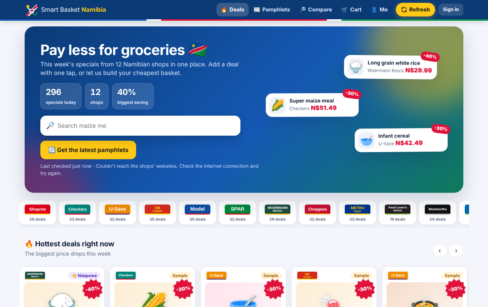
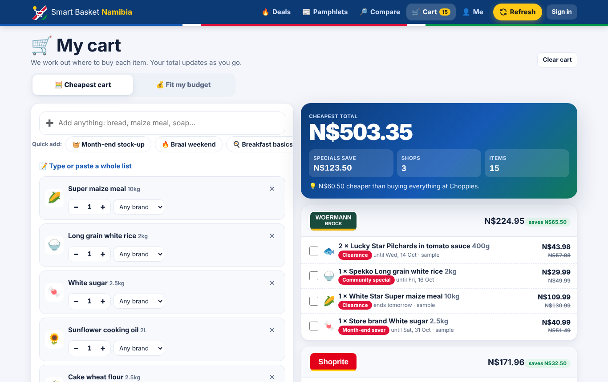
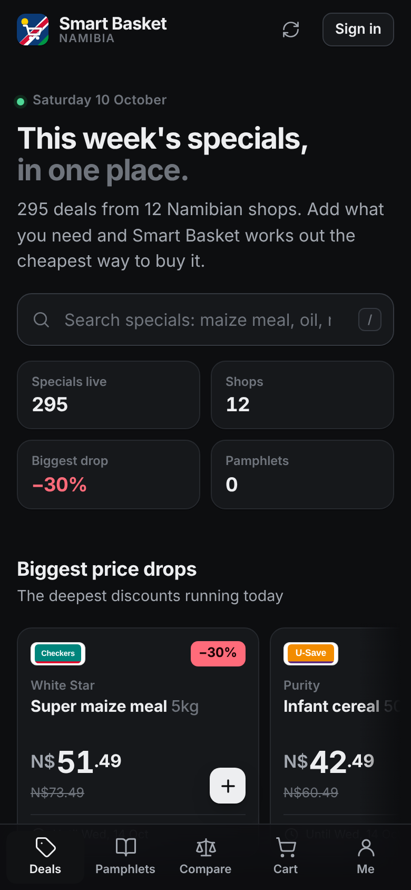

# Smart Basket Namibia 🛒🇳🇦

A web app that collects this week's specials from Namibian supermarkets and household
suppliers. It reads the shops' own pamphlets and turns them into one cheapest cart, or the best
cart for your budget. Anyone can browse; a free account saves lists and shops.

**Shops:** Shoprite, Checkers, U-Save, OK Foods, Model (Pick n Pay Namibia became Model on
1 July 2025), SPAR, Woermann Brock, Choppies, Metro, Food Lover's Market, Woolworths Food and
Clicks. The list lives in `data/stores.json`. An import that still says "Pick n Pay" goes to Model.

| Deals (desktop) | Cheapest cart | Phone, dark mode |
|---|---|---|
|  |  |  |

More screenshots: [one-tap baskets](previews/deals-baskets.png), [budget cart](previews/budget.png),
[price comparison](previews/compare.png), [refresh progress](previews/refresh.png),
[cart on a phone](previews/mobile-cart.png). They show the built-in sample prices.

## Download for Mac

Get **Smart Basket Namibia** from the repository's **Releases** page, release **Smart Basket Namibia — Mac app**
(tag `smart-basket-mac`):

* **Apple chip (M1 and later)**: `Smart-Basket-Namibia-Mac-AppleSilicon.dmg`
* **Intel Mac**: `Smart-Basket-Namibia-Mac-Intel.dmg`

To check which you have: Apple menu → **About This Mac**. "Chip: Apple M…" means Apple chip;
"Processor: …Intel…" means Intel.

1. Open the `.dmg` and drag **Smart Basket Namibia** onto **Applications**.
2. Open it from Applications. The app isn't registered with Apple, so the first time macOS
   won't open it. Close the message (**Done** on macOS 15, **OK** or **Cancel** on earlier
   versions), then go to **System Settings → Privacy & Security**, scroll down, click
   **Open Anyway** next to "Smart Basket Namibia" and confirm. This is needed only once.
   On macOS 14 and earlier you can instead Control-click the app and choose **Open**.
   Or, in Terminal: `xattr -dr com.apple.quarantine "/Applications/Smart Basket Namibia.app"`.
3. The app opens in its own window. Tap **Refresh** for this week's pamphlets. To have prices read
   from them automatically, tap **🤖 Connect Claude** and paste an Anthropic API key. The key is
   stored only on your Mac.

Requires macOS 11.3 (Big Sur) or later; each build is tested on macOS 15. The app runs entirely on
your Mac and is reachable only from it. The first account you create in it becomes its admin.
Your lists, pamphlets, settings and Claude key live in
`~/Library/Application Support/Smart Basket Namibia` (plus `app.log`, which helps if something goes wrong).
The cart and sign-in are kept by the app's window, in macOS's WebKit storage for the app. To
update, download the newest `.dmg` and replace the app; all of it is kept.
The app is built and tested by `.github/workflows/namshop-mac.yml`
(`namshop/desktop.py` is the launcher, `namshop/packaging/build_app.py` the PyInstaller build,
`namshop/packaging/check_min_macos.py` checks that every bundled library runs on macOS 11.3).
To build it yourself on a Mac:
`pip install -r namshop/requirements.txt -r namshop/packaging/requirements-build.txt && python namshop/packaging/build_app.py`.

## What it does

| Page | What you can do |
|---|---|
| 🔥 **Deals** | Every special running today. You get live counters, floating "hottest deal" cards, an auto-scrolling carousel of the biggest price drops, and shop logos you tap to filter. The grid loads more as you scroll. Tap **＋ Add** and the item flies into your cart. |
| ⚡ **One-tap baskets** | Month-end stock-up, Braai weekend, Breakfast basics, Baby essentials, Cleaning day and Student survival, each showing what it costs today. One tap builds the cart. |
| 📰 **Pamphlets** | Each shop's latest pamphlet with its cover, dates and how many prices were read from it. Open it to flip through the pages or the PDF. |
| 🔄 **Refresh** | The yellow button fetches the newest pamphlet from every shop. A progress panel shows each shop's logo moving through searching → downloading → reading with Claude → done. New prices go straight into Deals, Compare and the cart. |
| 🔎 **Compare** | Any product's price at every shop, cheapest first, with unit prices and specials. |
| 🛒 **Cart → Cheapest** | Add by search, quick basket, or by pasting a list (`2 x bread`, `maize meal 10kg`, `18 eggs`…). Pick any brand or a specific one. The total updates live as you change things. Under **⚙️ Shops & travel** you choose your shops, how many you'll visit, and a taxi/fuel cost per shop. |
| 💰 **Cart → Fit my budget** | Drag the budget slider and watch the gauge and cart update. Mark items ⭐ Must have, High, Medium or Nice to have; must-haves always go in and the rest fill the budget in order. You also see what didn't fit and roughly how much more it would cost. |
| 👤 **Me** | Sign up or sign in, saved lists, my shops, profile and password, **📣 Share a special** spotted in store, and admin tools for admins. |

Plans can be sent to WhatsApp, copied or printed as a tick-off list. The interface uses
[Motion](https://motion.dev) (bundled, MIT) for its animations: staggered card entrances, counters
that count up, spring transitions, fly-to-cart, confetti on wins and view transitions between
pages. It respects the system "reduce motion" setting and works in light and dark mode.

## Where prices come from

1. **Shop pamphlets (the Refresh button).** `leaflets.py` opens each shop's specials pages listed in
   `data/leaflet_sources.json`, finds the current pamphlets and downloads them. It handles PDF links,
   leaflet images, and FlippingBook flipbooks like `specials.shoprite.com.na/deals/…`, which it reads
   as a PDF download or as page images. It only fetches where robots.txt allows. A pamphlet that
   hasn't changed is skipped.
2. **Claude reads the prices.** New pamphlets go to Claude (model `claude-opus-5-5`,
   `NAMSHOP_CLAUDE_MODEL` to change). Claude returns every product, brand, size, normal price,
   special price and validity date as structured JSON, which becomes specials tagged
   "📰 Pamphlet". Server-side refusal fallback is switched on: if the model declines a pamphlet, the
   API retries on another model. Without a key, pamphlets are still fetched and shown on the
   Pamphlets page, just not turned into prices. To connect Claude, set `ANTHROPIC_API_KEY`, or paste
   a key on the Me page under Admin (stored in `~/.namshop/anthropic_api_key`, readable only by you).
3. **Specials.NA and other aggregators.** These are listed as extra sources for shops without their
   own pamphlet page, such as U-Save.
4. **Imports and feeds.** CSV/JSON uploads on the admin page or `python -m namshop import FILE`, and
   URLs in `~/.namshop/sources.json`. See `data/import_template.csv`.
5. **Community reports.** Shoppers share specials they see in store.

While running, the server refreshes everything every 6 hours (`NAMSHOP_REFRESH_HOURS`, 0 = only on
demand). Anyone can press Refresh, and a second press within 15 minutes just shows the last result
(`NAMSHOP_REFRESH_MIN_GAP`, in seconds).

Until real data arrives, **sample prices** fill the gaps so the app works out of the box. They are
tagged "Sample" and are replaced by real prices shop by shop. Turn them off on the admin panel or
with `python -m namshop sample off`.

**About the pamphlet sources.** The shop URLs come from desk research in October 2026. The
environment this was built in couldn't open any shop website, so the fetcher was tested against
saved copies of the expected page structure, not the live sites. On first run on a normal internet
connection, check the Refresh panel. A shop that shows "No pamphlet found" or "Couldn't reach" needs
its entry in `leaflet_sources.json` adjusted. Copy the file to `~/.namshop/leaflet_sources.json`
and edit it there.

### Real shop logos

On start-up and on every Refresh, the app downloads each shop's real logo from its own website
(header logo or app icon), or from Wikimedia Commons where a file exists (SPAR, Choppies,
Woolworths). Logos are cached in `~/.namshop/logos/`. SVGs are cleaned of scripts and served with a
strict content-security policy. Until a logo is downloaded, a badge in the shop's colours is shown.
You can also drop your own `~/.namshop/logos/<shop id>.png` (or `.svg`, `.jpg`, `.webp`). Logos
belong to their owners.

### Import format

CSV (comma, semicolon or tab separated) or a JSON list of objects. Header names are
case-insensitive. Only `store` and a price are required.

| Column | Meaning |
|---|---|
| `store` | Shop id or name (`shoprite`, `Pick n Pay`, …) |
| `item`, `size`, `brand`, `category` | Product. Leaflet-style names such as `Top Score Super Maize Meal 10kg` work too. |
| `product_id` / `item_id` | Target an existing catalogue entry exactly. |
| `price` | Normal shelf price (N$). |
| `special_price`, `special_label` | Promo price and its name. |
| `valid_from`, `valid_until` | Dates, `YYYY-MM-DD` or `DD/MM/YYYY`. Expired specials disappear by themselves. |
| `branch` | Optional branch or town. |

## Run it

Needs Python 3.10+.

```bash
pip install -r namshop/requirements.txt
export ANTHROPIC_API_KEY=sk-ant-...        # optional: lets the app read pamphlet prices
python -m namshop serve --open             # http://127.0.0.1:8000
```

Or double-click **`Start Smart Basket.command`** (macOS) / **`Start Smart Basket.bat`** (Windows).

To let phones on the same Wi-Fi use it, run `python -m namshop serve --host 0.0.0.0`. To host it
on the internet, put it behind HTTPS (Caddy or nginx) and set `NAMSHOP_SECURE_COOKIES=1`.
To make yourself admin after registering, run `python -m namshop make-admin you@example.com`.

Other commands: `python -m namshop import FILE [--store ID]`, `refresh` (pamphlets, logos and feeds),
`sample on|off`, `stats`. Data lives in `~/.namshop/` (or `NAMSHOP_DATA`). API docs are at
`/api/docs`.

## How the cart optimiser works

Each shop's cheapest matching product for each line (specials applied) feeds a small
mixed-integer programme, solved exactly with HiGHS via PuLP. A cheapest cart covers as much of the
list as the shop limit allows, then minimises item cost plus travel. A budget cart keeps must-haves
as hard constraints and scores the rest 6/4/2 by priority for the first unit and half that for extra
units. It maximises that score within the budget, then minimises cost.

## Accounts and security

Passwords are hashed with PBKDF2-SHA256 (260k iterations). Sessions use random tokens stored hashed,
in an HttpOnly SameSite=Lax cookie. Failed sign-ins are throttled. Pamphlet files are served only
from the data folder (no path traversal). Downloaded SVG logos are cleaned of scripts, and the
Claude key file is readable only by its owner.

## Layout

```
namshop/
  data/stores.json          shops, logo colours and logo sources
  data/leaflet_sources.json where each shop publishes its pamphlets
  data/catalog.json         everyday groceries & household basics
  data/baskets.json         the one-tap baskets
  leaflets.py               pamphlet discovery, download, Claude reading, Refresh manager
  net.py                    polite fetching, robots.txt, link discovery
  logos.py                  real logo download + badge fallback
  db.py  sample.py  deals.py  optimizer.py  importer.py  auth.py  server.py  cli.py
  static/                   single-page app (HTML/CSS/JS, Motion in static/vendor)
  tests/                    python -m pytest namshop/tests
```
